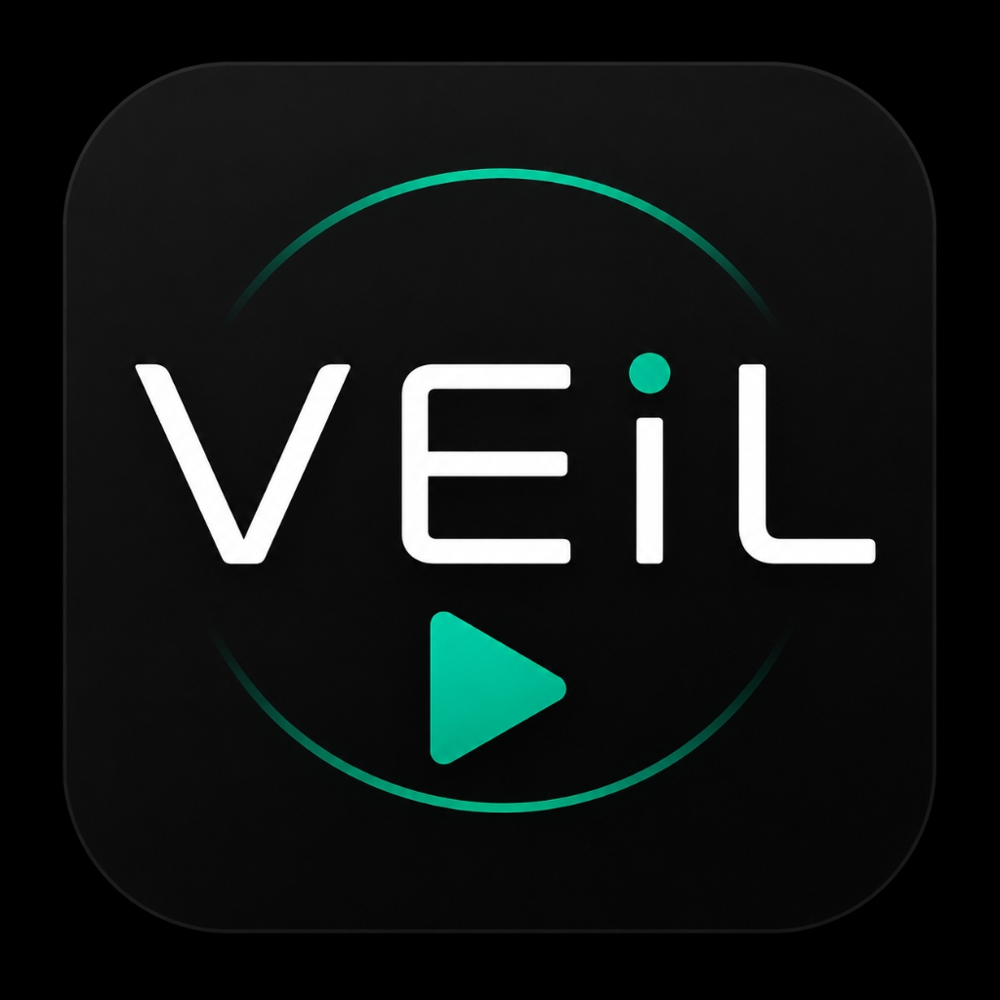

<p align="center">
  
</p>

<h1 align="center">Veil Player</h1>

<p align="center">
  <strong>A high-performance, AMOLED-optimized, offline-first media player for Android.</strong>
</p>

<p align="center">
  
  
  
  
  
</p>

---

## Overview

Modern mobile media players are often weighed down by streaming advertisements, invasive background tracking, mandatory account logins, and bloated cloud ecosystems. 

**Veil Player** was engineered around a simple philosophy: **your local media belongs to you.** It is an ultra-fast, clean, and distraction-free audio and video player built with Flutter and native Android components. It operates with **zero network permissions**, stores all settings locally, and features a pure `#000000` AMOLED dark theme designed to minimize battery consumption on OLED displays.

Powered by `media_kit` (backed by libmpv), Veil Player leverages native hardware acceleration for fluid high-bitrate video playback while providing robust software fallback for legacy media formats.

---

## User Interface & Design

Veil Player uses a curated AMOLED design language optimized for high contrast, low battery drain, and fluid 120Hz refresh rates:

- **Dual-Experience Navigation**: Seamless bottom navigation switching between dedicated **Video** and **Music** libraries.
- **Persistent Floating Mini-Player**: A floating audio pill remains visible across all navigation tabs, displaying live playback progress, track info, and playback controls without interrupting library browsing.
- **Gesture-Driven Playback**: Full-screen video interface with intuitive swipe zones for volume, screen brightness, and scrub seeking.
- **Unified Micro-Animations**: Smooth sheet dismissals, ripple feedback on double-taps, and responsive progress controls.

---

## Verified Feature List

### 🎬 Video Playback
- **High-Performance Playback Engine**: Powered by `media_kit` (libmpv backend) with native hardware acceleration (`MediaCodec`) and automatic software decoding fallback.
- **Gesture Controls**:
  - Left edge vertical swipe: Screen brightness adjustment.
  - Right edge vertical swipe: System media volume adjustment.
  - Horizontal swipe: Precision scrubbing with time delta preview overlay.
  - Double-tap left / right: Instant 10-second skip with animated ripple indicators.
  - Long-press: Smooth 2.0x playback speed preview with haptic feedback.
- **Audio & Subtitle Track Management**:
  - Embedded multi-track audio selection.
  - Embedded subtitle track switching.
  - Automatic external subtitle detection (`.srt`, `.vtt`, `.ass`, `.ssa` files residing in the same folder).
  - Manual subtitle synchronization delay adjustments.
- **Display & Framing**:
  - Aspect ratio switching: Fit, Stretch, 16:9, 4:3, and Zoom / Crop.
  - Orientation toggle: Landscape lock, portrait lock, and sensor-based auto-rotation.
  - One-tap screen touch lock to prevent accidental gestures.
- **Picture-in-Picture (PiP)**: Native Android Picture-in-Picture multitasking with automatic aspect ratio preservation.
- **Playback Tools**:
  - Sleep timer ('Off', 15m, 30m, 60m, or 'End of Video').
  - Focus Mode (Do Not Disturb integration via notification policy).
  - Technical Media Inspector: Real-time sheet displaying container format, resolution, video/audio codecs, framerate, bitrate, and active decoder.
- **Fault-Tolerant Recovery**: Gracefully handles corrupted, 0-byte, or missing media files with an in-player error HUD offering actionable **Retry** and **Skip to Next** controls.

### 🎵 Music & Audio Playback
- **Comprehensive Audio Library**: Organized into **Tracks**, **Folders**, **Playlists**, and **Search** views.
- **Dedicated Foreground Audio Service**: Native Android service (`VeilAudioService`) running with `mediaPlayback` foreground type, ensuring uninterrupted background playback when the app is minimized or the screen is locked.
- **Full Player & Mini-Player**:
  - Interactive Now Playing screen with album art, track scrub bar, and volume controls.
  - Persistent floating bottom mini-player pill accessible across all app views.
- **Queue Management**:
  - Dynamic playback queue with reordering, item removal, and "Add to Queue".
  - Repeat modes (`Off`, `Repeat All`, `Repeat One`).
  - True Fisher-Yates shuffle engine with index preservation.
- **Safe State Persistence**:
  - Atomic JSON queue persistence (`AudioStorageService`) guarantees queue state, playback position, and recently played lists survive app restarts without file corruption.
- **Android Media Integration**:
  - MediaSession integration with lock-screen controls and notification actions (Play, Pause, Previous, Next).
  - Smart AudioFocus management: Automatically pauses on incoming phone calls or when headphones are disconnected, and gracefully resumes when appropriate.

### 📁 Library & File Management
- **Smart Quick Access**: Automatically detects and surfaces media directories including Camera, Downloads, Movies, and custom storage folders.
- **Noise Filtering**: Aggressively filters out system cache directories, temporary folders, thumbnails, `.nomedia` directories, zero-byte files, and messaging app stickers.
- **History & Progress**: Retains watch history, video resume positions, and last-watched folder pointers.
- **Local File Operations**: Rename, delete (via Storage Access Framework), copy/move clipboard with conflict resolution, and share via Android system sheet.
- **Hierarchical Folder Browsing**: Directory tree view showing item counts, paths, and total folder sizes.

### 🔒 Privacy & Diagnostics
- **100% Offline**: Veil Player does **not** request or declare the `android.permission.INTERNET` permission.
- **Zero Telemetry**: No third-party analytics, crash trackers, or advertising SDKs are packaged.
- **Local Diagnostic Engine**: Captures crash logs and playback anomalies strictly to private app storage (`<app-dir>/veil_diagnostics/reports`).
- **Privacy Path Sanitizer**: Built-in multi-pass sanitizer automatically redacts personal file paths, storage prefixes, OS usernames, IP addresses, and media filenames from diagnostic text before viewing or sharing.
- **User-Initiated Sharing**: Diagnostic reports can only be shared or drafted into an email if the user explicitly triggers the action from the report viewer.

---

## Tech Stack

| Component | Implementation |
|---|---|
| **UI Framework** | [Flutter](https://flutter.dev) (Dart 3) |
| **State Management** | [Riverpod](https://riverpod.dev) (v2.6) |
| **Media Engine** | [media_kit](https://github.com/media-kit/media-kit) (libmpv backend) |
| **Android Integration** | Kotlin (`MainActivity.kt`, `VeilAudioService.kt`) |
| **Audio Service** | Android Foreground Service (`mediaPlayback`), MediaSession |
| **Styling** | Custom AMOLED Pure Black (`#000000`) theme tokens |
| **File Sharing** | Android `FileProvider` (local-only report export) |

---

## Permissions Breakdown

Veil Player strictly requests permissions necessary for local media discovery and playback:

| Permission | Purpose |
|---|---|
| `READ_MEDIA_VIDEO` | Access local video files on Android 13+ (API 33+). |
| `READ_MEDIA_AUDIO` | Access local audio and music files on Android 13+ (API 33+). |
| `READ_MEDIA_VISUAL_USER_SELECTED` | Support Photo/Media Picker partial selections on Android 14+ (API 34+). |
| `READ_EXTERNAL_STORAGE` | Access media files on Android 12 and below (maxSdkVersion 32). |
| `WRITE_EXTERNAL_STORAGE` | Support file operations on legacy Android versions (maxSdkVersion 29). |
| `MANAGE_EXTERNAL_STORAGE` | Optional permission requested only when the user performs advanced file management (moving, deleting, or renaming media outside app-private storage on Android 11+). |
| `FOREGROUND_SERVICE` | Maintain continuous background audio playback. |
| `FOREGROUND_SERVICE_MEDIA_PLAYBACK` | Android 14+ requirement for foreground media playback services. |
| `POST_NOTIFICATIONS` | Display playback controls in the notification drawer on Android 13+. |
| `ACCESS_NOTIFICATION_POLICY` | Enable Focus Mode (temporarily silencing Do Not Disturb during video playback). |
| **`INTERNET`** | **NOT REQUESTED.** The application has no internet access capability. |

---

## System Requirements

### For End Users
- **Operating System**: Android 5.0 (API Level 21) or higher.
- **Architecture**: `arm64-v8a`, `armeabi-v7a`, or `x86_64`.
- **Recommended**: Android 10+ with an AMOLED / OLED display.

### For Developers Building from Source
- **Flutter SDK**: 3.10.0 or higher
- **Dart SDK**: 3.0.0 or higher
- **Java Development Kit**: JDK 17
- **Android SDK**: API Level 34 (compileSdk / targetSdk)
- **Gradle**: 8.0+

---

## Installation

### Downloading Pre-built Release APK
1. Navigate to the [Releases](https://github.com/rohitmorerocks/Veil_Player/releases) section of this repository.
2. Download the latest `app-release.apk`.
3. On your Android device, open the downloaded APK file.
4. If prompted, allow your browser or file manager to "Install apps from unknown sources".
5. Complete installation and grant media access when launched.

> **Security Note:** Only download Veil Player APKs from the official GitHub repository releases page. Never download unofficial builds from third-party APK mirrors.

---

## Building from Source

To compile Veil Player locally:

```bash
# 1. Clone the repository
git clone https://github.com/rohitmorerocks/Veil_Player.git
cd Veil_Player

# 2. Fetch Flutter dependencies
flutter pub get

# 3. Verify static analysis
flutter analyze

# 4. Run automated test suite
flutter test

# 5. Compile release APK
flutter build apk --release
```

The compiled release APK will be located at:
```text
build/app/outputs/flutter-apk/app-release.apk
```

---

## Known Limitations

- **Platform Scope**: Veil Player is designed exclusively for Android. Desktop and iOS targets are not currently supported.
- **Hardware Codec Availability**: Hardware decoding relies on device-specific `MediaCodec` implementations. Obscure or unsupported codecs automatically fall back to CPU software decoding, which may increase battery consumption on older processors.
- **Scoped Storage Boundaries**: On Android 11+, modifying or deleting media files across separate physical SD cards or non-media folders requires granting system Storage Access Framework access.

---

## Contributing

Contributions are welcome! Please read [CONTRIBUTING.md](CONTRIBUTING.md) before submitting pull requests.

To report bugs or suggest enhancements:
1. Check existing [Issues](https://github.com/rohitmorerocks/Veil_Player/issues) to avoid duplicates.
2. Open a detailed issue report including your device model, Android version, and steps to reproduce.

---

## License

Veil Player is open-source software licensed under the **MIT License**. See the [LICENSE](LICENSE) file for complete license terms.
